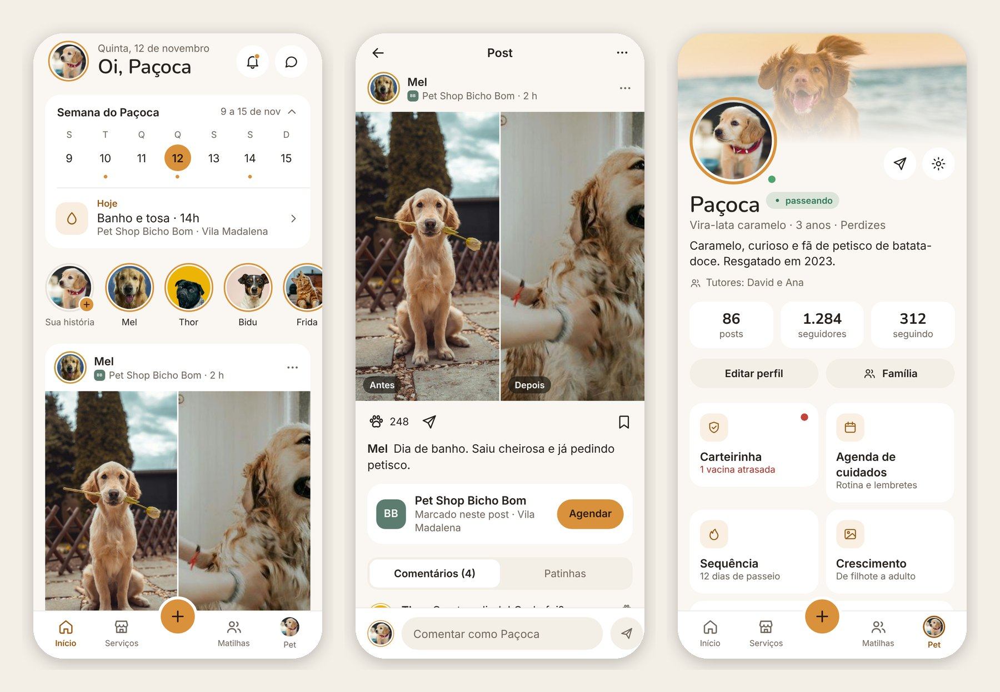
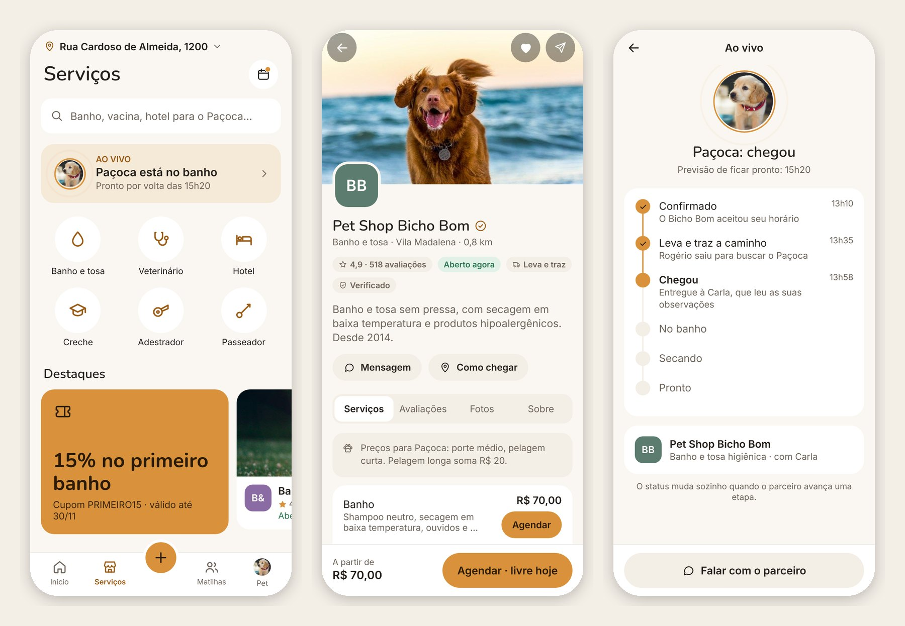
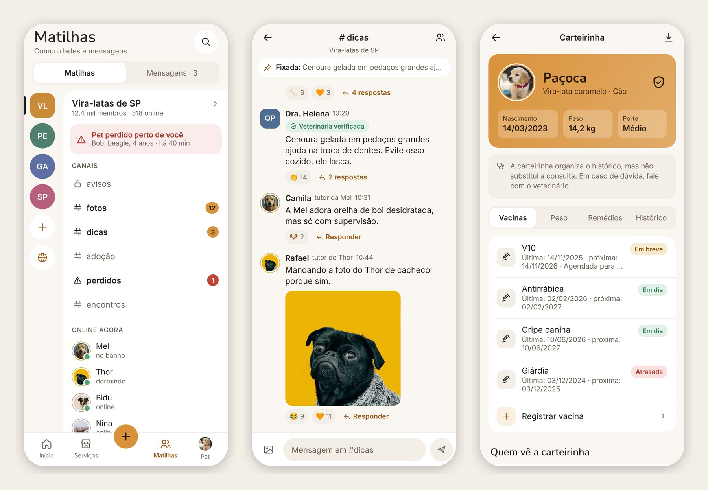
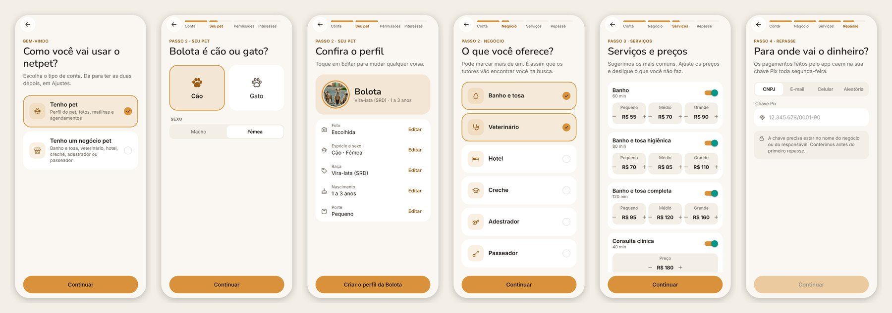
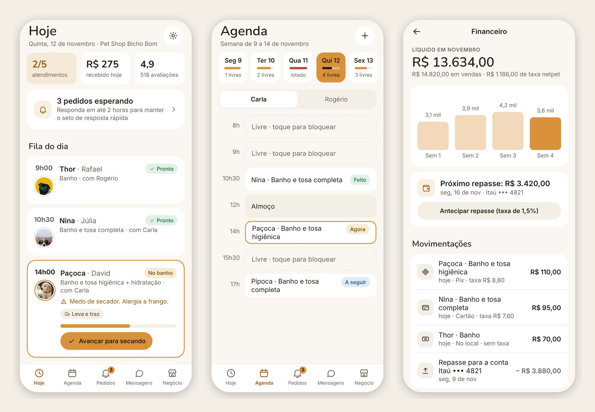
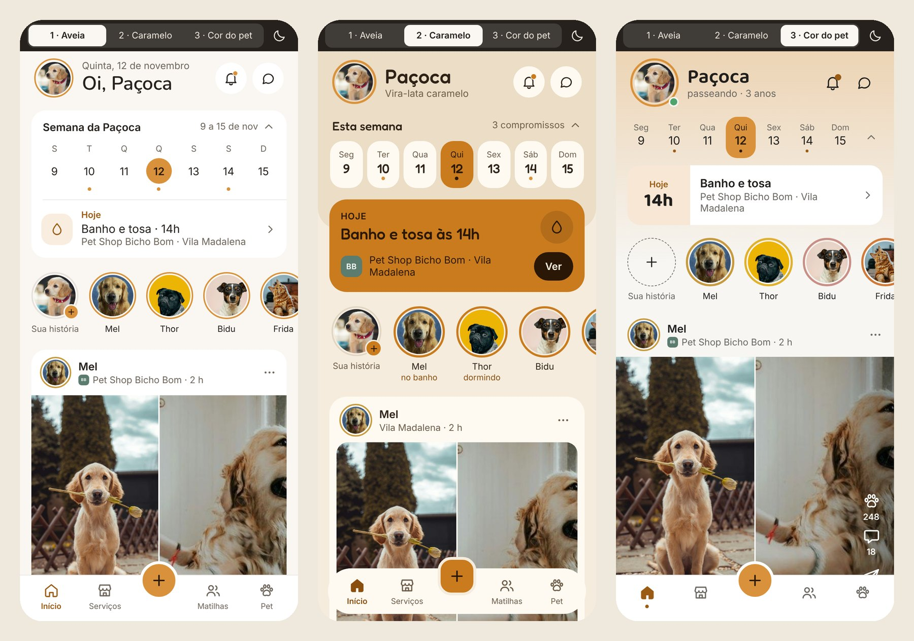
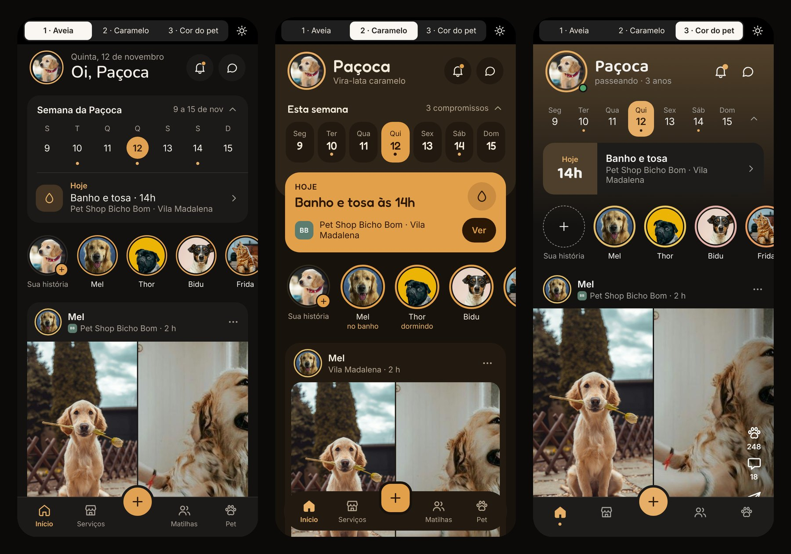

<div align="center">


### A rede social em que o perfil é do pet.

Fotos e vídeos dos bichos, comunidades por raça e bairro, e banho e tosa, veterinário, hotel e passeador perto de casa, com agendamento em poucos toques.


</div>

<br />

<p align="center">
  
</p>

## O ciclo do netpet

O app liga as duas metades do produto, a rede social e os serviços, num ciclo só:

1. **Descobre.** O tutor vê um parceiro no feed ou na busca e agenda.
2. **Acompanha.** Durante o atendimento, segue o status ao vivo: chegou, no banho, secando, pronto para buscar.
3. **Posta.** O parceiro envia a foto do "depois", que vira post no perfil do pet com o parceiro marcado.
4. **Recomeça.** Os seguidores veem o post, tocam no parceiro e agendam.

| Palavra | O que é |
| --- | --- |
| **Pet** | O protagonista e dono do perfil. Um tutor pode ter vários pets. |
| **Tutor** | A pessoa. Um pet pode ter mais de um tutor, a família. |
| **Patinha** | A curtida. Dois toques na foto carimbam uma patinha. |
| **Matilha** | Comunidade com canais, por raça, bairro ou interesse. |
| **Parceiro** | O estabelecimento ou profissional: pet shop, clínica, hotel, adestrador. |
| **Carteirinha** | O histórico de saúde do pet: vacinas, peso, remédios e consultas. |

## Ver no seu celular

**Jeito mais rápido:** instale o Expo Go e escaneie este QR code. Não precisa de computador.

<p align="center">
  
</p>

O QR code abre o [Snack do netpet](https://snack.expo.dev/8Hu8QHw06ya5M72c3thbr), uma cópia do app que não se atualiza sozinha. Para publicar uma cópia nova depois de mudar o código, rode `python3 scripts/publish-snack.py` e troque o link e o QR code acima.

**Rodando do código:**

Você precisa do [Node.js](https://nodejs.org) 20 ou mais novo no computador e do app **Expo Go** no celular ([App Store](https://apps.apple.com/app/expo-go/id982107779) · [Google Play](https://play.google.com/store/apps/details?id=host.exp.exponent)).

```bash
git clone https://github.com/dhqdev/netpet.git
cd netpet
npm install
npx expo start
```

Um QR code aparece no terminal.

- **iPhone:** aponte a câmera para o QR code e toque no aviso do Expo Go.
- **Android:** abra o Expo Go e toque em *Scan QR code*.

O celular e o computador precisam estar na mesma rede Wi-Fi. Se não abrir (rede do trabalho, VPN, roteador que isola aparelhos), rode `npx expo start --tunnel` e escaneie de novo.

Quer só ver no navegador? `npx expo start --web`.

## O que tem no app

Todas as abas e fluxos funcionam, com dados de exemplo guardados no próprio app. Nada vai para um servidor: ao fechar, tudo volta ao começo.

| Área | Telas |
| --- | --- |
| **Cadastro** | Abertura, boas-vindas, escolha do tipo de conta e dois caminhos: **tutor** (conta, foto do pet pela câmera ou galeria, nome, espécie, raça, idade, porte, cor, revisão, permissões e interesses) e **estabelecimento** (conta, tipo de negócio, dados com CNPJ ou CPF, endereço por CEP, serviços e preços por porte, horários, fotos, Pix e revisão) |
| **Início e social** | Feed, histórias, post com comentários e patinhas, criar post, registrar cuidado, notificações, busca e o assistente netpet |
| **Serviços** | Vitrine por categoria, resultados com filtros e mapa, página do parceiro, agendamento, resumo e pagamento (Pix, cartão ou no local), confirmação, meus agendamentos, atendimento ao vivo, avaliação e cupons |
| **Matilhas** | Canais, conversa, fio de respostas, mensagens diretas, sobre a matilha, descobrir, criar matilha e o alerta de pet perdido |
| **Pet** | Perfil, editar, família, carteirinha (vacinas, peso, remédios e histórico), agenda de cuidados, crescimento, sequência de passeios, retrospectiva, cartão para compartilhar e plaquinha com QR code |
| **Geral** | Ajustes (conta, aparência, notificações, privacidade, pagamentos, endereços, bloqueados, ajuda), excluir conta, netpet+ e estados vazios, de erro, sem internet e carregando |
| **Modo parceiro** | Fila do dia com etapas ao vivo, agenda por profissional, pedidos (aceitar, recusar ou sugerir outro horário), mensagens, catálogo, clientes, avaliações com resposta, financeiro, planos, destaque na busca, cupons, verificação e equipe |

<p align="center">
  
</p>

<p align="center">
  
</p>

### Roteiro para testar

1. **Cadastro:** passe pelas boas-vindas e escolha *Tenho pet* ou *Tenho um negócio pet*. O pet criado vira o pet ativo do app; o negócio abre direto no modo parceiro.
2. **Agendar:** em Serviços, abra o Pet Shop Bicho Bom, toque em Agendar, escolha um horário e pague com Pix.
3. **Ao vivo:** no Início, toque no cartão de hoje para acompanhar o banho do Paçoca. Ao terminar, a foto do depois vira post.
4. **Postar:** o **+** no topo do Início abre Postar, Agendar, Registrar cuidado e Avisar pet perdido.
5. **Patinha:** dois toques em qualquer foto. O **⋯** de cada post tem salvar, denunciar e bloquear.
6. **Trocar de pet:** toque no avatar do topo do Início. Segure para ver a lista.
7. **Estilo e tema:** em Ajustes, *Aparência*, escolha entre as três direções e entre claro, escuro ou o tema do celular.
8. **Modo parceiro:** em Ajustes, *Modo parceiro*. Inicie um atendimento, avance as etapas e aceite um pedido. Para voltar, *Negócio*, *Voltar para o modo tutor*.
9. **Atalho:** em Ajustes, *Mapa de telas* abre qualquer tela direto.

## Cadastro e movimento

O cadastro começa perguntando quem você é. Cada caminho mostra no topo em que parte você está (Conta, Seu pet ou Negócio, Serviços, Repasse), faz uma pergunta por tela e termina numa revisão em que dá para editar qualquer resposta.

<p align="center">
  
</p>

- **Vidro:** menu inferior flutuante, cabeçalhos, folhas e botões sobre foto usam o Liquid Glass de verdade no iOS 26 e um vidro desfocado nos outros sistemas.
- **Expansão:** ao tocar num cartão, a tela nova cresce a partir dele e volta para ele. As outras entram pela direita, e arrastar da borda esquerda volta.
- **Molas e vibração:** tudo anda em molas suaves, o conteúdo entra em cascata e as ações importantes dão um toque leve de vibração.

## O modo parceiro

O mesmo app, do lado do Pet Shop Bicho Bom: cada etapa que o parceiro marca chega na hora para o tutor.

<p align="center">
  
</p>

## Como o netpet ganha dinheiro

- **Taxa por agendamento pago no app:** 12% no plano grátis do parceiro e 8% no Parceiro Pro. Pagamento no local não tem taxa.
- **Parceiro Pro:** R$ 89 por mês, com agenda por profissional, lembretes automáticos de retorno, relatórios e cupons.
- **Destaque na busca:** o parceiro paga por dia para aparecer primeiro, sempre com o rótulo *Patrocinado*.
- **netpet+ para tutores:** R$ 14,90 por mês ou R$ 149 por ano, sem taxa de serviço, carteirinha em PDF e família ilimitada.
- **Plaquinha de metal com QR code:** R$ 39,90.
- **Sempre grátis:** a carteirinha básica e o alerta de pet perdido.

## Três estilos para escolher

O app inteiro funciona nos três estilos. Troque em Ajustes, *Aparência*.

| | Estilo | A ideia |
| --- | --- | --- |
| **1** | **Aveia** | Calma e arejada. Cartões brancos sobre o fundo aveia, separadores finíssimos e o caramelo só no essencial. Títulos em Nunito. |
| **2** | **Caramelo** | Quente e com mais marca. Faixa tingida no topo, cartão "Hoje" preenchido de caramelo e barra inferior flutuante. Títulos em Fredoka. |
| **3** | **Cor do pet** | A foto manda. Neutros de pedra e o app inteiro no tom do pet ativo, que muda quando você troca de pet. Títulos em Baloo 2. |

<p align="center">
  
</p>

E os três no tema escuro:

<p align="center">
  
</p>

## Identidade

| Token | Claro | Escuro | Uso |
| --- | --- | --- | --- |
| Caramelo | `#D9923B` | `#E0A152` | Ações principais, dia de hoje, patinha |
| Caramelo de texto | `#9A5B14` | `#E6AE66` | Texto em caramelo, com contraste acima de 4,5:1 |
| Aveia | `#FAF7F2` | `#121110` | Fundo |
| Superfície | `#FFFFFF` | `#1C1A18` | Cartões, um degrau acima do fundo |
| Texto | `#26211C` | `#F3EEE7` | Corpo |
| Texto de apoio | `#6F665C` | `#A79F95` | Legendas e metadados |

- **Formas:** pet sempre em círculo com anel na cor dele, parceiro sempre em quadrado arredondado, para distinguir de relance.
- **Ícones:** um conjunto próprio, em traço de 1,7 com pontas arredondadas.
- **Movimento:** de 140 a 220 ms, com saída suave e toque que encolhe 3%. Nada quica.
- **Tom de voz:** "O banho da Mel é amanhã às 14h", e não "Au au! Hora do banhinho!".
- **Anúncios:** sempre com o rótulo "Patrocinado" e nunca disfarçados de post.

## Estrutura

```
App.js                tema, abas, folhas e o registro de todas as telas
src/
  theme.js            tokens de cor, fonte e raio dos três estilos
  store.js            estado do app em memória: posts, agendamentos, mensagens, ajustes
  nav.js              navegação leve: uma aba ativa e uma pilha de telas por cima
  motion.js           molas, vidro (Liquid Glass no iOS 26), vibração leve e entrada em cascata
  kit.js              componentes: tela, botão, cartão, lista, campo, chips, estados
  ui.js               toque, avatar do pet, marca do parceiro, mídia do post, folha
  icons.js            conjunto de ícones em SVG
  data.js             conteúdo de exemplo: pets, parceiros, agenda, posts, matilhas, saúde
  home/               o Início em cada um dos três estilos
  screens/
    entrada.js        abertura e cadastro de tutor e de estabelecimento
    social.js         post, história, criar post, cuidado, notificações e busca
    servicos.js       vitrine, parceiro, agendamento, pagamento, ao vivo e avaliação
    matilhas.js       canais, conversas, mensagens e pet perdido
    pet.js            perfil, carteirinha, cuidados, crescimento e plaquinha
    geral.js          assistente, ajustes, netpet+, estados e mapa de telas
    parceiro.js       o modo parceiro inteiro
assets/
  photos/             fotos de exemplo
  fonts/              Nunito, Fredoka e Baloo 2
scripts/
  publish-snack.py    publica uma cópia nova no Expo Snack
docs/                 logo e capturas deste README
server/               API em Node + banco Postgres (veja server/README.md)
```

A navegação é própria, e não o Expo Router, para o app rodar igual no Expo Snack e no Expo Go sem passo de build.

## Próximos passos

- [x] Três estilos visuais e sistema de design
- [x] Entrada, Início, social, serviços, matilhas, pet, ajustes e modo parceiro
- [x] Back-end: contas, fotos, agendamentos e mensagens de verdade ([server/](server/README.md))
- [ ] Ligar as telas do app à API
- [ ] Pagamentos com Pix e cartão por uma processadora
- [ ] Notificações push e localização para o alerta de pet perdido
- [ ] Publicar nas lojas com EAS Build

## Créditos

- Fotos de exemplo do [Unsplash](https://unsplash.com), sob a licença Unsplash. Os IDs estão em `assets/photos/unsplash-ids.json`.
- Fontes [Nunito](https://fonts.google.com/specimen/Nunito), [Fredoka](https://fonts.google.com/specimen/Fredoka) e [Baloo 2](https://fonts.google.com/specimen/Baloo+2), sob a SIL Open Font License.
- Pets, tutores, parceiros e bairros dos exemplos são fictícios.
