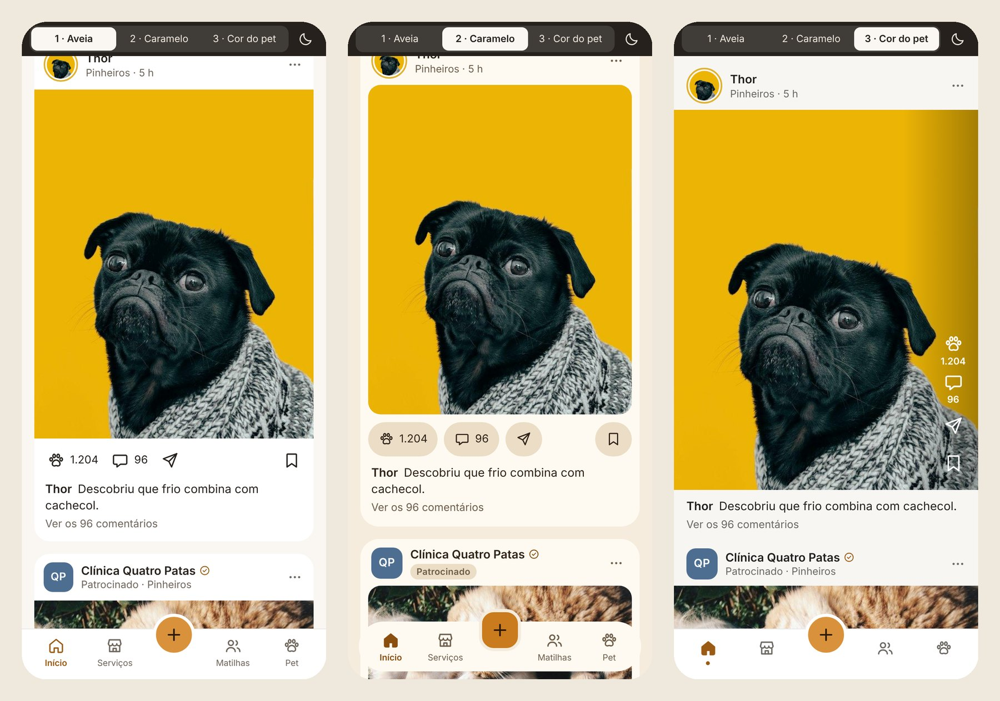
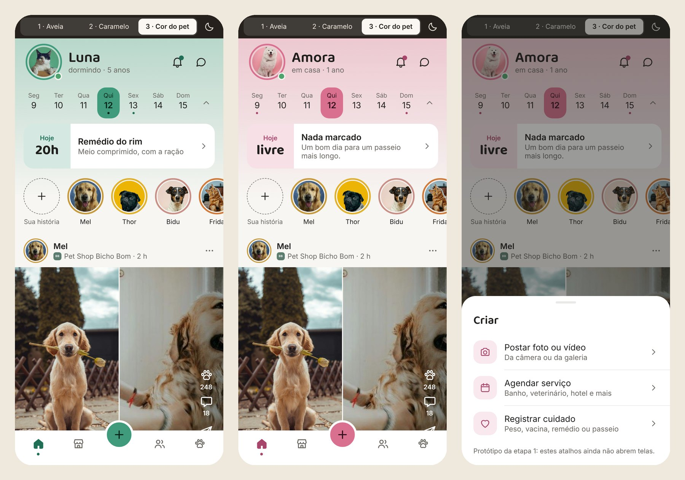

<div align="center">


### A rede social em que o perfil é do pet.

Fotos e vídeos dos bichos, comunidades por raça e bairro, e banho e tosa, veterinário, hotel e passeador perto de casa, com agendamento em poucos toques.


</div>

<br />

<p align="center">
  
</p>

## O ciclo do netpet

O app liga as duas metades do produto, a rede social e os serviços, num ciclo só:

1. **Descobre.** O tutor vê um parceiro no feed ou na busca e agenda.
2. **Acompanha.** Durante o atendimento, segue o status ao vivo: chegou, no banho, secando, pronto para buscar.
3. **Posta.** O parceiro envia a foto do "depois", que vira post no perfil do pet com o parceiro marcado.
4. **Recomeça.** Os seguidores veem o post, tocam no parceiro e agendam.

| Palavra | O que é |
| --- | --- |
| **Pet** | O protagonista e dono do perfil. Um tutor pode ter vários pets. |
| **Tutor** | A pessoa. Um pet pode ter mais de um tutor, a família. |
| **Patinha** | A curtida. Dois toques na foto carimbam uma patinha. |
| **Matilha** | Comunidade com canais, por raça, bairro ou interesse. |
| **Parceiro** | O estabelecimento ou profissional: pet shop, clínica, hotel, adestrador. |
| **Carteirinha** | O histórico de saúde do pet: vacinas, peso, remédios e consultas. |

## Ver no seu celular

**Jeito mais rápido:** instale o Expo Go e escaneie este QR code. Não precisa de computador.

<p align="center">
  
</p>

O QR code abre o [Snack do netpet](https://snack.expo.dev/mgcmLHwOFcMhDRpySRSWm), uma cópia do app que não se atualiza sozinha. Para publicar uma cópia nova depois de mudar o código, rode `python3 scripts/publish-snack.py` e troque o link e o QR code acima.

**Rodando do código:**

Você precisa do [Node.js](https://nodejs.org) 20 ou mais novo no computador e do app **Expo Go** no celular ([App Store](https://apps.apple.com/app/expo-go/id982107779) · [Google Play](https://play.google.com/store/apps/details?id=host.exp.exponent)).

```bash
git clone https://github.com/dhqdev/netpet.git
cd netpet
npm install
npx expo start
```

Um QR code aparece no terminal.

- **iPhone:** aponte a câmera para o QR code e toque no aviso do Expo Go.
- **Android:** abra o Expo Go e toque em *Scan QR code*.

O celular e o computador precisam estar na mesma rede Wi-Fi. Se não abrir (rede do trabalho, VPN, roteador que isola aparelhos), rode `npx expo start --tunnel` e escaneie de novo.

Quer só ver no navegador? `npx expo start --web`.

## O que testar

A faixa escura no topo é do protótipo, não do app. Ela troca a direção visual e o tema claro ou escuro.

- **Trocar de pet:** toque no avatar do topo para alternar entre Paçoca, Luna e Amora. Segure para abrir a lista.
- **Semana:** toque nos dias para ver o compromisso de cada um, e recolha a faixa pela setinha.
- **Patinha:** dois toques em qualquer foto.
- **Carrossel e vídeo:** deslize as fotos da Luna. O post da Amora mostra o formato de vídeo curto.
- **Criar:** o botão **+** abre a folha com Postar, Agendar e Registrar cuidado.
- **Denunciar e bloquear:** pelo **⋯** de qualquer post.

## Três direções para o Início

A etapa 1 é a mesma tela em três caminhos visuais, para escolher um antes de construir o resto.

| | Direção | A ideia |
| --- | --- | --- |
| **1** | **Aveia** | Calma e arejada. Cartões brancos sobre o fundo aveia, separadores finíssimos e o caramelo só no essencial. Títulos em Nunito. |
| **2** | **Caramelo** | Quente e com mais marca. Faixa tingida no topo, dias em pílulas, o cartão "Hoje" preenchido de caramelo e o parceiro em destaque nos posts. Títulos em Fredoka. |
| **3** | **Cor do pet** | A foto manda. Neutros de pedra, o app inteiro no tom do pet ativo e fotos de ponta a ponta, com as ações sobre a imagem. Títulos em Baloo 2. |

<p align="center">
  
</p>

Na direção 3, cada pet tem uma cor tirada da foto dele, e o app muda de tom quando você troca de pet:

<p align="center">
  
</p>

E as três no tema escuro:

<p align="center">
  
</p>

## Identidade

| Token | Claro | Escuro | Uso |
| --- | --- | --- | --- |
| Caramelo | `#D9923B` | `#E0A152` | Ações principais, dia de hoje, patinha |
| Caramelo de texto | `#9A5B14` | `#E6AE66` | Texto em caramelo, com contraste acima de 4,5:1 |
| Aveia | `#FAF7F2` | `#121110` | Fundo |
| Superfície | `#FFFFFF` | `#1C1A18` | Cartões, um degrau acima do fundo |
| Texto | `#26211C` | `#F3EEE7` | Corpo |
| Texto de apoio | `#6F665C` | `#A79F95` | Legendas e metadados |

- **Formas:** pet sempre em círculo com anel na cor dele, parceiro sempre em quadrado arredondado, para distinguir de relance.
- **Ícones:** um conjunto próprio, em traço de 1,7 com pontas arredondadas.
- **Movimento:** de 140 a 220 ms, com saída suave e toque que encolhe 3%. Nada quica.
- **Tom de voz:** "O banho da Mel é amanhã às 14h", e não "Au au! Hora do banhinho!".
- **Anúncios:** sempre com o rótulo "Patrocinado" e nunca disfarçados de post.

## Estrutura

```
App.js              moldura do protótipo, barra inferior e folhas
src/
  theme.js          tokens de cor, fonte e raio das três direções
  icons.js          conjunto de ícones em SVG
  data.js           conteúdo de exemplo: pets, parceiros, agenda e posts
  ui.js             peças comuns: toque, avatar, marca de parceiro, mídia do post, folha
  home/
    HomeAveia.js    direção 1
    HomeCaramelo.js direção 2
    HomePet.js      direção 3
assets/
  photos/           fotos de exemplo
  fonts/            Nunito, Fredoka e Baloo 2
docs/               logo e capturas deste README
```

## Próximas etapas

- [x] **1. Fundação:** três direções visuais para o Início
- [ ] **2. Sistema de design:** tokens, componentes e barra inferior da direção escolhida
- [ ] **3. Núcleo social:** entrada, criar pet, Início, post, Criar e perfil do pet
- [ ] **4. Serviços:** vitrine, parceiro, agendamento, pagamento, atendimento ao vivo e avaliação
- [ ] **5. Matilhas e mensagens,** com o alerta de pet perdido
- [ ] **6. Pet:** carteirinha, agenda de cuidados, crescimento, sequência, retrospectiva e plaquinha
- [ ] **7. Modo parceiro**
- [ ] **8. Fechamento:** monetização, ajustes, estados vazios e de erro e o mapa de navegação

## Créditos

- Fotos de exemplo do [Unsplash](https://unsplash.com), sob a licença Unsplash. Os IDs estão em `assets/photos/unsplash-ids.json`.
- Fontes [Nunito](https://fonts.google.com/specimen/Nunito), [Fredoka](https://fonts.google.com/specimen/Fredoka) e [Baloo 2](https://fonts.google.com/specimen/Baloo+2), sob a SIL Open Font License.
- Pets, tutores, parceiros e bairros dos exemplos são fictícios.
